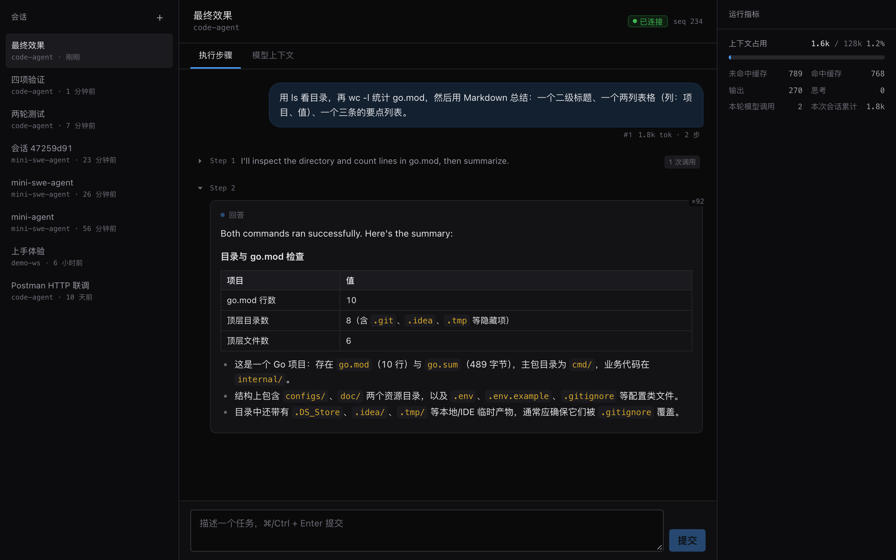
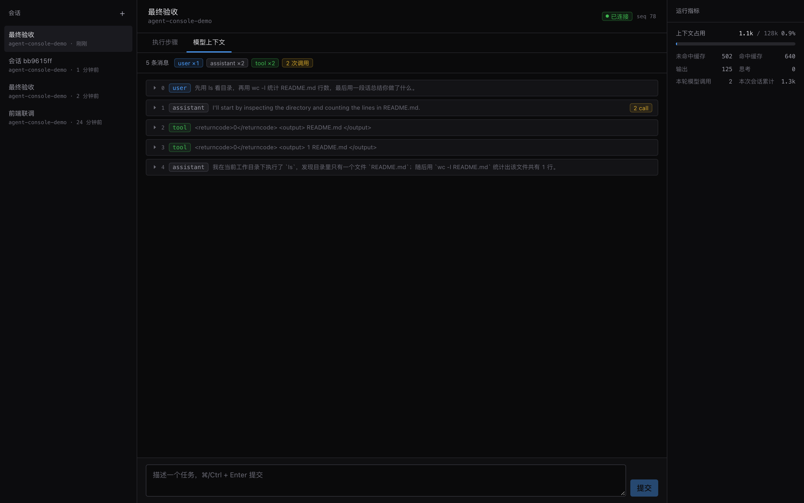

# agent-console

`code-agent` 的执行可视化面板。不是聊天界面——它展示的是 Agent **内部**的运行状态：每一步模型调用、每一次工具执行、上下文窗口占用、以及模型真正看到的消息历史。



_执行步骤视图：Turn → Step → Item 三层结构，命令卡片带退出码与耗时，右侧是上下文窗口监控。这张图是**刷新页面之后**截的——轮次的输入文本、用量、步骤层次全部从快照还原，不是靠内存里残留的状态。_



_模型上下文检查器：Agent 真正看到的消息历史。同一次工具调用在上图是一张卡片，在这里是 assistant + tool 两条消息——两种粒度服务两种目的。_

## 它解决什么问题

Agent 跑起来之后是个黑盒：你只看得到最终回答，看不到它为什么这么答。这个面板把黑盒摊开：

- **执行步骤可视化** — Turn → Step → Item 三层结构，一眼看出跑了几步、每步干了什么
- **工具调用详情** — 命令行、输出、退出码、耗时、是否被截断/超时
- **流式输出** — 正文和思考过程实时逐字出现；结束后按 Markdown 排版（表格、代码块、列表）
- **上下文窗口监控** — 已用 / 上限，输入侧拆成命中缓存与未命中（计价不同）
- **模型上下文检查器** — 模型看到的完整消息历史，含 `tool_calls` 参数原文和 `reasoning_content`

最后一项是这个面板区别于普通聊天界面的地方：模型行为诡异时，十次里有九次是上下文里混进了不该有的东西，而这是唯一能直接看到的地方。

## 快速开始

```bash
npm install

# 方式一：连真实后端（需要先启动 code-agent-server）
npm run dev

# 方式二：连 mock 后端，不烧 API 额度
npm run mock &     # :8080，回放一份真实会话日志
npm run dev        # :5173
```

打开 http://localhost:5173

启动真实后端：

```bash
cd ../code-agent
go run ./cmd/code-agent-server \
  -workspace /path/to/your/projects \
  -data .tmp/code-agent/sessions
```

说明：

- **`-workspace` 是「允许的根目录」，不是「唯一的工作目录」**。会话可以选它
  或它下面的任意子目录，所以通常指向一个**包含多个项目的父目录**。越界的
  请求会在建会话时就返回 400，前端在输入框下面内联提示。
  需要完全不受限时加 `-allow-any-workspace`（默认关，因为那等于放弃执行边界）。

- **API key 不用手动 export**。后端用 godotenv 自动读 `code-agent/.env` 里的
  `DEEPSEEK_API_KEY`，只要在 `code-agent/` 目录下启动就行。
- **不用加 `-cors`**。前端通过 Vite 的 `/api` 代理访问后端，浏览器看到的是同源请求。
  只有在前端直连 `:8080`（不走代理）时才需要开 CORS。
- `-workspace` 指向的目录**必须已存在**，后端在启动时就校验，不存在会直接退出。

### mock 后端能做的事

它按原始时间间隔回放 `src/test/fixtures/real-session.jsonl`（一次真实运行的 463 条事件），接口形状与 Go 后端完全一致。价值不只是省钱——它能**按需制造**真实后端很难复现的情况：

```bash
MOCK_SPEED=20 npm run mock    # 20 倍速，跑回归
MOCK_DROP=1 npm run mock      # 随机丢事件，验证前端的 seq 缺口自检与重新同步
```

指望真实模型恰好在你想要的时刻出错是不现实的。

## 命令

| 命令 | 作用 |
|---|---|
| `npm run dev` | 开发服务器，`/api` 代理到 `:8080` |
| `npm run mock` | 协议级 mock 后端 |
| `npm test` | 41 个测试 |
| `npm run typecheck` | `tsc --noEmit` |
| `npm run build` | 生产构建（首屏 121 KB gzipped + 按需的 Markdown chunk 46 KB） |

## 架构速览

```
app/          路由、Provider 装配
features/     页面与业务组件
hooks/        编排（useThreadLive）
store/        状态（TanStack Query + 自建实时 store）
api/ realtime/   协议翻译
types/        与 Go 结构体对齐的契约类型
```

依赖方向严格向下。判据：**"把 React 换成别的框架，这段要不要重写？"** 不用重写的在下层。

三类状态用三套机制：

| 类别 | 机制 | 判据（刷新页面后这个值从哪来？） |
|---|---|---|
| 服务端资源 | TanStack Query | 从服务器重新请求 |
| 实时事件投影 | 自建 store + `useSyncExternalStore` | 从事件流重放 |
| 纯 UI 状态 | `useState` | 回到默认值 |

Context 只用来**注入依赖**（`ApiClient`、store 引用、Toast 派发），不装状态——因为流式输出实测 **139 条 delta/秒**，而 Context 的 value 一变会让所有 consumer 无差别重渲染。

完整论证见 [doc/](doc/)。

## 文档

| 文档 | 什么时候读 |
|---|---|
| [React 应答手册](doc/react-review-notes.md) | 准备 Code Review。每处非平凡决策的理由 + 可能被追问的点 + 自测清单 |
| [前端架构总纲](doc/architecture/frontend-blueprint.md) | 理解选型、分层、目录、测试策略 |
| [状态模型与实时层](doc/architecture/state-and-realtime.md) | 理解最难的那部分：三套状态机制、SSE、rAF 合并 |
| [后端契约实录](doc/backend-contract.md) | 对接后端、排查联调问题 |

## 测试

41 个测试，分四层：

| 层 | 关键点 |
|---|---|
| reducer | **用真实的 463 条事件日志**，不是手写 fixture |
| 编排 | 假 `EventSource`，覆盖订阅起点、StrictMode 清理、缺口恢复 |
| 展示组件 | `CommandExecutionCard` 的六种状态 |
| **架构** | 灌 100 条 delta，断言时间线重渲染 **0 次** |

最后一条守的不是功能而是设计意图：如果有人把 Item 对象直接塞进步骤结构，功能测试全都还会过，但流式输出会从"重渲染 1 个组件"退化成"重渲染 N 个"——只有这条测试能发现。

## 对后端的改动

写这个面板的过程中发现并修复了**七处**后端契约缺口，都在 `../code-agent`，每处配了 Go 回归测试：

1. `Item` 加 `turn_id` / `step` —— 快照原本画不出层次（实时流有、快照丢了）
2. `Snapshot` 加 `context_window` —— 打开历史会话时进度条没有分母
3. `usage` 重放语义修正 —— 进程重启后跨轮累计会变成"最后一轮的量"
4. `Snapshot` 加 `TurnMeta` —— 刷新后看不到"用户这一轮问了什么"
5. SSE 建流后立刻发一行注释 —— 否则代理不转发响应头，`EventSource` 永远停在 CONNECTING
6. 空切片序列化成 `[]` 而不是 `null` —— 否则**新建的空会话必然白屏**
7. **工作目录真正按会话生效** —— 此前 `Thread.Meta.Workspace` 只是个标签，所有会话
   都跑在服务启动时的 `-workspace` 里，前端那个输入框形同虚设（设计文档说的是按会话）

最后两条都只有真机才会暴露：第 5 条单元测试测不出来（测试用 `httptest` 直连，中间没有代理），第 6 条只在"一个 item 都没有"的空会话上出现，而测试 fixture 总是有数据的。详见 [后端契约实录](doc/backend-contract.md)。

前端对每条都保留了降级路径（字段标可选、缺失时走兜底），所以前后端可以独立发布。

## 已知不足

- 命令输出不是流式的（后端当前一次性返回，协议留了口子但后端还没实现）
- 没有虚拟滚动（几百张卡片全挂 DOM，目前没到瓶颈）
- 没有固化的 E2E（`mock-server/` 已为此准备好，差把驱动脚本写成测试）
- 可访问性只做了基础（有 `aria-expanded` / `role` / `aria-live`，没做 focus trap 和完整键盘导航）
